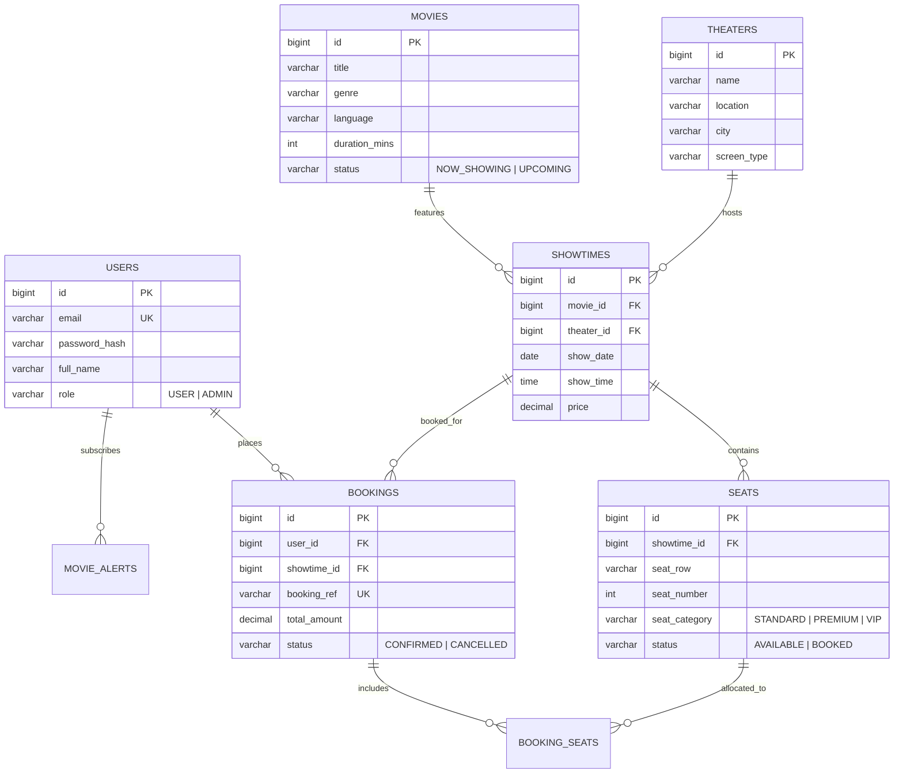

# FILM CLUB (CINE-AI) — Curated Cinema Discovery & High-Concurrency Ticketing Platform

[](https://spring.io/projects/spring-boot)
[](https://www.oracle.com/java/)
[](https://www.postgresql.org/)
[](https://redis.io/)
[](https://react.dev/)
[](https://tailwindcss.com/)
[](LICENSE)

A full-stack, enterprise-grade theatrical film discovery and seat booking engine built with **Spring Boot 3.3.5 (Java 21)** and **React 18 (Vite + Tailwind CSS)**. Features a dual-layer concurrency control architecture with **Redis** in-memory soft holds and **PostgreSQL** pessimistic write locking (`SELECT FOR UPDATE`) to prevent race conditions during peak seat reservation bursts.

---

## 🌟 Key Features

- **Editorial 3D Repertoire Discovery**: Browse Now Showing and Upcoming Premiere films categorized by genre (Action, Sci-Fi, Horror, Drama) with real-time metadata, runtime, rating, and high-resolution posters.
- **Two-Layer Concurrency Control**:
  - **Layer 1 (Redis)**: Atomic sub-millisecond 5-minute temporary seat hold with TTL key-expiry.
  - **Layer 2 (PostgreSQL)**: Row-level pessimistic write locking (`@Lock(LockModeType.PESSIMISTIC_WRITE)`) during checkout to eliminate double-booking anomalies under concurrent traffic.
- **Automated Event-Driven Release Alert Engine**: Patrons subscribe to upcoming releases with preferred venues; when theatrical showtimes are published, the engine automatically promotes the film to *Now Showing* and triggers instant notifications (`TICKETS OPEN`).
- **Interactive 2D Seat Matrix**: Visual tier-based auditorium maps (Standard, Premium, VIP) reflecting real-time seat availability (`available`, `held`, `booked`).
- **Digital Ticket Pass & Verification**: Unique alphanumeric ticket reference (`BK-XXXXXX`) generation with seat and auditorium breakdown.
- **Role-Based Access Control (RBAC)**: Stateless JWT authentication (HMAC-SHA256) with hardened public endpoints and protected Curator management tools.
- **Restricted Curator / Admin Console**: Full management suite for adding film titles, updating screening status, configuring venues/screens, and publishing theatrical showtimes.
- **Interactive Swagger / OpenAPI 3 Documentation**: Interactive API documentation supporting Bearer token authorization and reverse-proxy HTTPS protocol awareness.

---

## 🏗️ Architecture & Technology Stack

```
                          ┌─────────────────────────────────────┐
                          │    React 18 + Vite + Tailwind UI    │
                          └──────────────────┬──────────────────┘
                                             │ HTTPS
                                             ▼
                          ┌─────────────────────────────────────┐
                          │    Spring Boot 3.3.5 (Java 21)      │
                          │   Stateless JWT Security Filter     │
                          └──────────┬────────────────┬─────────┘
                                     │                │
            5-Min Temporary Hold TTL │                │ ACID Transactions &
            (Fast Atomic Lock)       │                │ Pessimistic Row Lock
                                     ▼                ▼
                          ┌─────────────────┐  ┌────────────────┐
                          │     Redis 7     │  │  PostgreSQL 16 │
                          │  In-Memory Key  │  │  Primary Store │
                          └─────────────────┘  └────────────────┘
```

| Component | Technology | Description |
|---|---|---|
| **Backend Framework** | Spring Boot 3.3.5 | REST controllers, Spring Data JPA, validation, async task executors |
| **Language** | Java 21 (LTS) | Modern Java idioms, pattern matching, records |
| **Primary Database** | PostgreSQL 16 | Relational schema, ACID compliance, foreign keys, row-level locks |
| **In-Memory Cache** | Redis 7 | Distributed temporary seat holds with TTL expiry (`SETNX`) |
| **Security** | Spring Security 6 + JJWT | Stateless JWT auth, BCrypt password hashing, method-level RBAC |
| **API Documentation** | Springdoc OpenAPI 2.6.0 | Swagger UI with relative origin routing and Bearer token testing |
| **Frontend** | React 18 + TypeScript + Vite | Editorial typography, responsive design, Lucide icons |
| **Styling** | Tailwind CSS | Modern minimalist aesthetics |
| **Deployment** | Docker & Railway | Multi-stage Docker containers with reverse proxy header integration |

---

## 🗄️ Database Entity Schema



---

## ⚡ Concurrency Model: How Seat Double-Booking is Prevented

1. **User Selects Seat (`POST /api/holds`)**:
   - Backend attempts an atomic `SETNX` in Redis: `seat_hold:{showtimeId}:{seatId}` = `userId` with a **5-minute TTL**.
   - If another user holds the seat, it rejects in `<2ms` with `409 Conflict`.
   - Generates a cryptographically secure `holdToken` mapped to the user and seats.
2. **User Confirms Checkout (`POST /api/bookings`)**:
   - `BookingService` executes inside `@Transactional`.
   - Acquires a database-level pessimistic write lock:
     ```sql
     SELECT * FROM seats WHERE id IN (:seatIds) FOR UPDATE;
     ```
   - Confirms seat is not yet `BOOKED`, persists the booking, sets seat status to `BOOKED`, evicts the Redis hold keys, and commits the transaction.

---

## 📡 REST API Overview

Interactive Swagger UI documentation is available at `/swagger-ui/index.html`.

### Authentication (`/api/auth`)
- `POST /api/auth/register` — Create patron account (role strictly defaulted to `USER`).
- `POST /api/auth/login` — Authenticate and receive signed Bearer JWT token.
- `GET /api/auth/me` — Retrieve current authenticated user profile.

### Movies (`/api/movies`)
- `GET /api/movies` — Query repertoire with status, genre, language, and search filters.
- `GET /api/movies/{id}` — Movie details and synopsis.
- `GET /api/movies/{id}/showtimes` — List available screening schedules.
- `POST /api/movies` *(Admin)* — Register new film title.
- `PUT /api/movies/{id}` *(Admin)* — Update metadata or promote status (`UPCOMING` <-> `NOW_SHOWING`).
- `DELETE /api/movies/{id}` *(Admin)* — Remove movie and cascade delete showtimes.

### Showtimes & Seats (`/api/showtimes`)
- `GET /api/showtimes` — Query showtimes by theater, date, city.
- `GET /api/showtimes/{id}/seats` — Real-time interactive 2D seat matrix (`available`, `held`, `booked`).
- `POST /api/showtimes` *(Admin)* — Publish showtime (auto-generates seat layout and evaluates alerts).

### Seat Holds & Bookings (`/api/holds`, `/api/bookings`)
- `POST /api/holds` — Acquire 5-minute in-memory soft hold in Redis.
- `DELETE /api/holds/{token}` — Release hold early.
- `POST /api/bookings` — Finalize booking with pessimistic lock, generating digital ticket pass.
- `GET /api/bookings` — View user booking history.
- `GET /api/bookings/{ref}` — Public lookup for digital ticket pass by reference (`BK-XXXXXX`).
- `DELETE /api/bookings/{ref}` — Cancel booking and release seats back to `AVAILABLE`.

### Release Alerts (`/api/alerts`)
- `POST /api/alerts` — Subscribe to upcoming release notification.
- `GET /api/alerts` — View active alerts and ticketing status (`MONITORING RELEASE` vs `TICKETS OPEN`).
- `DELETE /api/alerts/{id}` — Cancel subscription.

---

## 🚀 Local Setup & Installation

### Prerequisites
- Java 21 JDK
- Node.js 20+ & npm
- Docker (for PostgreSQL and Redis)

### 1. Start Infrastructure Containers
```bash
# PostgreSQL (Port 5432)
docker run -d --name cineai-postgres -p 5432:5432 -e POSTGRES_DB=cineai -e POSTGRES_USER=postgres -e POSTGRES_PASSWORD=postgres postgres:16-alpine

# Redis (Port 6379)
docker run -d --name cineai-redis -p 6379:6379 redis:7-alpine
```

### 2. Configure Environment Variables
Copy `.env.example` to `.env`:
```bash
cp .env.example .env
```

### 3. Build & Run Backend
```bash
# Using Maven Wrapper (Windows PowerShell)
.\mvnw.cmd clean package -DskipTests
java -jar target/cineai-backend-0.0.1-SNAPSHOT.jar

# On Linux / macOS
./mvnw clean package -DskipTests
java -jar target/cineai-backend-0.0.1-SNAPSHOT.jar
```
Backend starts on `http://localhost:8080`. Swagger documentation is live at `http://localhost:8080/swagger-ui/index.html`.

### 4. Build & Run Frontend
```bash
cd frontend
npm install
npm run dev
```
Frontend launches at `http://localhost:3000`.

---

## 🔒 Production Hardening Details

- **Defense-in-Depth Against Privilege Escalation**: Public registration ignores the `role` field via `@JsonProperty(access = READ_ONLY)` and programmatically sets `UserRole.USER`.
- **Reverse Proxy HTTPS Protocol Alignment**: Configured `server.forward-headers-strategy: framework` and relative OpenAPI server URLs (`/`) to eliminate Mixed Content errors behind TLS-terminating proxies.
- **Asynchronous Task Offloading**: Email confirmations and alert notifications execute on a dedicated thread pool (`taskExecutor`), keeping HTTP booking responses under 30ms.
- **Production Seeder**: Seeds default administrative accounts using environment-injected passwords (`ADMIN_PASSWORD`), removing hardcoded credentials.

---

## 📄 License
This project is licensed under the MIT License — feel free to use and adapt it for educational and portfolio purposes.
