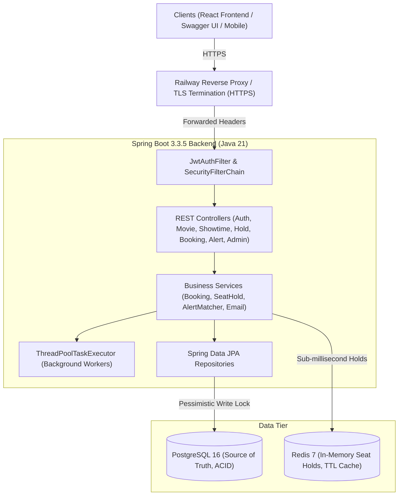
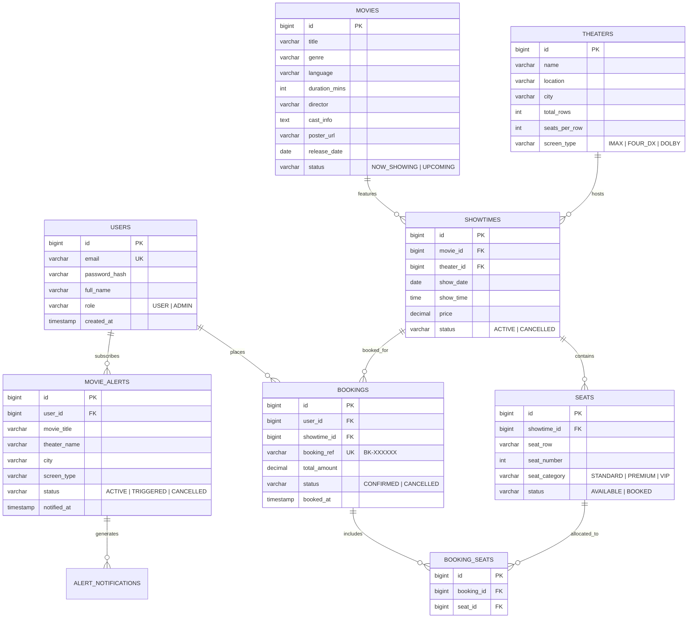
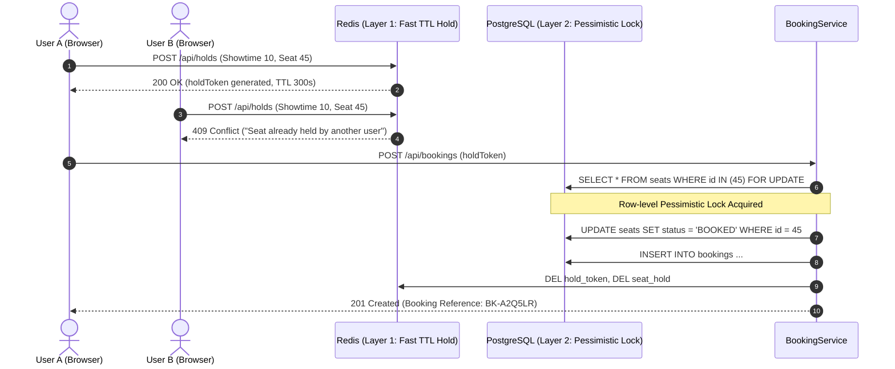
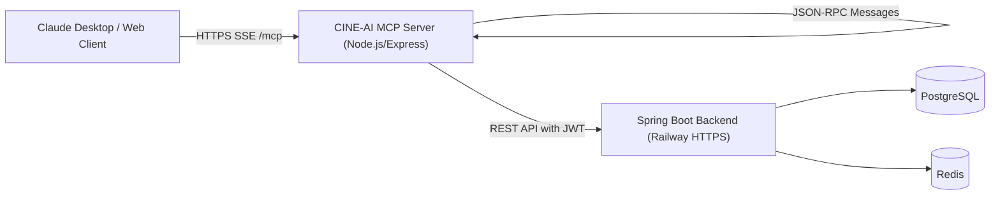

# CINE-AI — Backend Engineering & System Architecture Master Guide

> [!NOTE]
> This document is your complete interview prep and technical reference guide for your role as the **Backend Engineer** on **CINE-AI**. It details everything from architecture decisions and database design to concurrency control, security, and real-world trade-offs.

---

## 1. Executive Summary & Your Role

### What was your role on CINE-AI?
> *"I designed, implemented, and production-hardened the backend micro-architecture for CINE-AI — a high-concurrency theatrical discovery, seat reservation, and ticketing platform. My work centered around building a stateless **Spring Boot 3.3.5 / Java 21** application backed by **PostgreSQL** for relational persistence and ACID compliance, and **Redis** for sub-millisecond distributed in-memory seat holds and TTL expiry. I engineered a **two-layer concurrency control model** to prevent double-booking under burst traffic, implemented **stateless JWT security with RBAC**, built an **automated event-driven alert-matching engine**, and configured production deployment via Docker on Railway."*

---

## 2. Technology Stack & Architecture



### Core Technologies
| Component | Technology | Version | Purpose |
|---|---|---|---|
| **Language** | Java | 21 (LTS) | Modern Java features (Records, Pattern Matching, Virtual Threads ready) |
| **Framework** | Spring Boot | 3.3.5 | Core dependency injection, REST API, autoconfiguration |
| **Security** | Spring Security | 6.3.4 | Stateless filter chain, BCrypt hashing, method-level authorization |
| **Tokens** | JJWT | 0.11.5 | Cryptographic HMAC-SHA256 JWT generation and validation |
| **Relational DB** | PostgreSQL | 16 | Primary ACID transactional store for movies, showtimes, seats, bookings |
| **In-Memory Store** | Redis | 7.x | Fast distributed seat locking with 5-minute time-to-live (TTL) |
| **ORM / Data Access** | Hibernate / Spring Data JPA | 6.5.3 | Object-relational mapping, custom JPQL queries, locking |
| **Async & Scheduling** | Spring Task & Scheduling | Built-in | Background thread pool (`ThreadPoolTaskExecutor`) & cron matching |
| **Documentation** | Springdoc OpenAPI (Swagger UI) | 2.6.0 | Interactive API documentation supporting JWT Bearer authentication |
| **Containerization** | Docker | Multi-stage Alpine | Lean production container deployed on Railway |

---

## 3. Database Schema & Data Modeling



### Key Relationships & Foreign Keys
1. **Seat Matrix Generation**: When an admin publishes a `Showtime`, `SeatGeneratorService` dynamically builds `totalRows * seatsPerRow` distinct physical seats (`Seat` records) for that showtime, categorizing rows into `STANDARD`, `PREMIUM`, and `VIP`.
2. **Booking Join Table**: A booking links to multiple seats via `BOOKING_SEATS`. This preserves history even if showtimes are archived.
3. **Pessimistic Seat Status**: A seat in PostgreSQL has physical status `AVAILABLE` or `BOOKED`. Intermediate states (`HELD`) are offloaded to Redis to eliminate database locking overhead during casual browsing.

---

## 4. The High-Concurrency Seat Reservation Architecture

> [!IMPORTANT]
> **This is the #1 question asked in ticketing backend interviews**: *"How do you prevent two users from booking the exact same seat at the same second?"*

We solved this using a **Two-Layer Distributed Concurrency Architecture**:



### Layer 1: Distributed Soft Hold in Redis (Fast Fail & User Experience)
- When a user selects a seat on the 2D seat map, the frontend calls `POST /api/holds`.
- **Key Schema**: `seat_hold:{showtimeId}:{seatId}` stored with value `userId` and **TTL = 300 seconds (5 minutes)**.
- **Atomic Operation**: Redis `SETNX` (Set if Not Exists) with expiry. If already held by someone else, it fails instantly in `<2ms` without touching the relational database.
- A secondary token `hold_token:{UUID}` stores the tuple `{showtimeId}:{userId}:{seatIds}` for checkout verification.

### Layer 2: Pessimistic Row-Level Write Lock in PostgreSQL (ACID Guarantee)
- When the user submits checkout (`POST /api/bookings`), `BookingService` executes inside an isolated `@Transactional` boundary:
```java
// SeatRepository.java
@Lock(LockModeType.PESSIMISTIC_WRITE)
@Query("SELECT s FROM Seat s WHERE s.id IN :seatIds")
List<Seat> findByIdsWithLock(@Param("seatIds") List<Long> seatIds);
```
- PostgreSQL translates this into SQL:
  ```sql
  SELECT * FROM seats WHERE id IN (101, 102) FOR UPDATE;
  ```
- Any concurrent transaction attempting to read or write those exact seat rows is blocked until the active transaction commits or rolls back.
- If the seat is already `BOOKED`, a custom `SeatAlreadyBookedException` is thrown.
- Once updated to `BOOKED`, the Redis hold keys are evicted (`seatHoldService.releaseHeldSeats`), the transaction commits, and a unique booking reference (`BK-XXXXXX`) is returned.

---

## 5. Security & Authentication Architecture

### Stateless JWT Filter Chain
- **Custom Authentication**: Custom implementation of Spring Security 6 `SecurityFilterChain` with `SessionCreationPolicy.STATELESS`.
- **JWT Provider**: Generates cryptographically signed tokens (HMAC-SHA256) containing `userId`, `email`, and `roles`. Expiration set to 24 hours (`86400000 ms`).
- **Filter**: `JwtAuthFilter` intercepts every incoming request before `UsernamePasswordAuthenticationFilter`. It parses the `Authorization: Bearer <token>` header, validates the signature, loads the `UserPrincipal`, and populates the `SecurityContextHolder`.

### Role-Based Access Control (RBAC)
- Public routes: Browsing repertoire (`GET /api/movies/**`), showtimes (`GET /api/showtimes/**`), seat layouts (`GET /api/showtimes/*/seats`), and Swagger documentation (`/swagger-ui/**`, `/v3/api-docs/**`).
- Authenticated user routes: Reserving holds (`POST /api/holds`), confirming bookings (`POST /api/bookings`), creating alerts (`POST /api/alerts`), and cancellation (`DELETE /api/bookings/**`).
- Admin routes (`@PreAuthorize("hasRole('ADMIN')")` or `/api/admin/**`): Creating/updating/deleting movies, theaters, showtimes, and poster uploads.

### Security Hardening Measures Implemented
1. **Privilege Escalation Block**: Public registration (`POST /api/auth/register`) strictly ignores any `"role"` payload field via `@JsonProperty(access = READ_ONLY)` and hardcodes `request.setRole(UserRole.USER)`.
2. **Reverse Proxy Proto Forwarding**: Added `server.forward-headers-strategy: framework` to `application.yml` so that TLS termination at Railway's proxy forwards `X-Forwarded-Proto: https`, eliminating Mixed Content errors in Swagger UI.
3. **Password Security**: Passwords stored exclusively as salted hashes generated with `BCryptPasswordEncoder`.

---

## 6. The Automated Alert Matcher Engine

### The Problem
Patrons want to be notified when upcoming films (e.g., *Marty Supreme*, *Superman*, *The Conjuring: Last Rites*) open for advance booking.

### The Solution: Dual-Trigger Architecture
1. **Real-time Event Trigger**: When an admin publishes a showtime in `AdminService.createShowtime(...)`:
   - If the movie was `UPCOMING`, it is automatically promoted to `NOW_SHOWING`.
   - `alertMatcherService.checkAlertsForShowtime(saved)` runs synchronously in the transaction.
   - Any patron alert matching the movie title and preferred venue is immediately flipped from `ACTIVE` to `TRIGGERED`.
2. **Scheduled Reconciliation Job**: `AlertMatcherJob` runs via `@Scheduled(fixedRate = 15 minutes)` to catch showtimes scheduled in batches.
3. **Asynchronous Notification**:
   ```java
   @Async("taskExecutor")
   public void sendAlertNotification(MovieAlert alert, List<Showtime> matchingShowtimes) { ... }
   ```
   Uses a dedicated `ThreadPoolTaskExecutor` (core size 4, max 10, queue 50) so email sending never delays showtime creation or HTTP responses.

---

## 7. Complete API Reference

### Auth Endpoints (`/api/auth`)
| Method | Endpoint | Access | Description |
|---|---|---|---|
| `POST` | `/api/auth/register` | Public | Register new patron account (role strictly defaulted to `USER`) |
| `POST` | `/api/auth/login` | Public | Authenticate credentials and receive Bearer JWT |
| `GET` | `/api/auth/me` | Authenticated | Retrieve authenticated user profile |

### Movie Endpoints (`/api/movies`)
| Method | Endpoint | Access | Description |
|---|---|---|---|
| `GET` | `/api/movies` | Public | List all movies with filters (`showing`, `upcoming`, `genre`, `search`) |
| `GET` | `/api/movies/{id}` | Public | Get full details of a specific movie |
| `GET` | `/api/movies/{id}/showtimes` | Public | Retrieve showtimes scheduled for this movie |
| `POST` | `/api/movies` | Admin | Register new film title |
| `PUT` | `/api/movies/{id}` | Admin | Update film metadata or toggle status (`UPCOMING` <-> `NOW_SHOWING`) |
| `DELETE` | `/api/movies/{id}` | Admin | Remove movie and cascade delete its showtimes |

### Showtime & Seat Endpoints (`/api/showtimes`)
| Method | Endpoint | Access | Description |
|---|---|---|---|
| `GET` | `/api/showtimes` | Public | Query showtimes by `movieId`, `theatreId`, `date`, `city` |
| `GET` | `/api/showtimes/{id}` | Public | Get specific showtime details |
| `GET` | `/api/showtimes/{id}/seats` | Public | Get 2D seat matrix with real-time `available`, `held`, `booked` status |
| `POST` | `/api/showtimes` | Admin | Publish showtime; auto-generates seats and triggers alert matcher |
| `DELETE` | `/api/showtimes/{id}` | Admin | Cancel and remove showtime |

### Hold & Booking Endpoints (`/api/holds`, `/api/bookings`)
| Method | Endpoint | Access | Description |
|---|---|---|---|
| `POST` | `/api/holds` | Authenticated | Reserve temporary 5-minute hold on seat IDs in Redis |
| `DELETE` | `/api/holds/{token}` | Authenticated | Release hold token early |
| `POST` | `/api/bookings` | Authenticated | Execute pessimistic lock on held seats and confirm booking |
| `GET` | `/api/bookings` | Authenticated | List all bookings for the logged-in user |
| `GET` | `/api/bookings/{ref}` | Public | Digital ticket pass lookup by booking reference (`BK-XXXXXX`) |
| `DELETE` | `/api/bookings/{ref}` | Authenticated | Cancel booking and release seats back to `AVAILABLE` |

### Alert Endpoints (`/api/alerts`)
| Method | Endpoint | Access | Description |
|---|---|---|---|
| `POST` | `/api/alerts` | Authenticated | Subscribe to upcoming release alerts for a movie/venue |
| `GET` | `/api/alerts` | Authenticated | List user's active and triggered alerts |
| `DELETE` | `/api/alerts/{id}` | Authenticated | Unsubscribe from an alert |

---

## 5.5 Model Context Protocol (MCP) & AI Integration

### What is the CINE-AI MCP Server?
To enable conversational AI discovery and ticketing from **Claude Desktop** and web AI clients, we implemented an official **Model Context Protocol (MCP)** server (`mcp-server/`).



### Key Technical Architecture Decisions:
1. **Dual Transport Support**:
   - **Remote HTTPS with Server-Sent Events (SSE)**: Express server deployed to Railway with `/mcp` (SSE stream) and `/mcp/messages` (JSON-RPC tool dispatcher). Allows Claude to connect using Railway's public domain (`https://*.up.railway.app/mcp`) without requiring a custom domain or local ports.
   - **Local `stdio` Transport**: Supports local CLI and offline desktop testing (`node dist/index.js --stdio`).
2. **Session-Aware JWT Token Persistence**:
   - Claude and LLMs are fundamentally stateless and do not manage cookies or auth headers.
   - The MCP server maintains an in-memory `SessionStore` mapped to the client's `sessionId`.
   - When a user asks Claude: *"Register an account with email X"* or *"Log in as Y"*, the MCP tool executes the authentication call on the Spring Boot backend, captures the JWT Bearer token, and caches it in the active session.
   - All subsequent calls (`hold_seats`, `confirm_booking`, `create_alert`, `get_my_bookings`) automatically inject `Authorization: Bearer <cached_jwt>` behind the scenes.
3. **17 Native MCP Tools**: Exposes the entire ticketing surface (Authentication, Discovery, Showtimes, Seat Maps, Seat Recommendation algorithms, Redis Holds, PostgreSQL Bookings, and Release Alerts).

---

## 8. Master Interview Questions & Answers (Tiered: Easy, Medium, Hard)

---

### 🟢 Level 1: Fundamentals & Core Spring Boot (Easy)

#### Q1.1: "What is the difference between `@RestController` and `@Controller`, and how does response serialization work?"
> **How to answer**:
> *"In Spring MVC, `@Controller` is traditionally used for server-side rendered web applications returning view names (like Thymeleaf or JSP). `@RestController` is a convenience composed annotation introduced in Spring 4 that combines `@Controller` and `@ResponseBody`.*
> 
> *When a method in a `@RestController` returns an object (such as our `ApiResponse<MovieResponse>`), Spring's `HttpMessageConverter` mechanism (specifically `MappingJackson2HttpMessageConverter`) automatically serializes the Java object into a JSON string in the HTTP response body with `Content-Type: application/json`. It also bypasses the view resolver entirely."*
> 
> **Key Points**:
> - `@RestController = @Controller + @ResponseBody`.
> - Uses Jackson ObjectMapper under the hood.
> - Returns data payloads directly, not view names.

---

#### Q1.2: "What is Dependency Injection (DI) and Inversion of Control (IoC), and why is constructor injection preferred over `@Autowired` on fields?"
> **How to answer**:
> *"Inversion of Control (IoC) is the architectural principle where the control of object creation and lifecycle management is transferred from the application code to an IoC container (the Spring ApplicationContext). Dependency Injection (DI) is the concrete design pattern used to achieve IoC.*
> 
> *In CINE-AI, we exclusively use **constructor injection** rather than field injection (`@Autowired` on private fields) for three critical production reasons:*
> 1. ***Immutability***: *Dependencies can be declared `final`, ensuring thread-safety once instantiated.*
> 2. ***Testability***: *In unit tests (such as our `AdminServiceTest`), we can easily pass mock instances (`Mockito.mock(...)`) without needing complex reflection or Spring runner overhead.*
> 3. ***Fail-Fast Initialization***: *If a required dependency is missing, the application fails immediately at compile time or startup with a clear `NoSuchBeanDefinitionException` rather than producing runtime `NullPointerException`s later."*

---

#### Q1.3: "How does Spring Data JPA handle database queries without writing SQL?"
> **How to answer**:
> *"Spring Data JPA provides repository abstraction over the JPA EntityManager. At startup, Spring analyzes interface definitions extending `JpaRepository` and generates proxy implementations dynamically via Java Dynamic Proxies.*
> 
> *It supports queries in two ways:*
> 1. ***Method Name Parsing (Query Derivation)***: *Spring parses method names like `findByBookingRef(String ref)` or `existsByEmail(String email)`. It tokenizes keywords (`findBy`, `existsBy`, `OrderBy...Desc`) and derives the corresponding JPQL/SQL AST automatically.*
> 2. ***Custom JPQL / Native SQL via `@Query`***: *For complex operations — such as our pessimistic locking query `findByIdsWithLock` — we define explicit JPQL using `@Query` and `@Lock(LockModeType.PESSIMISTIC_WRITE)` to execute fine-tuned database queries."*

---

#### Q1.4: "What is the lifecycle and scope of a Spring Bean? What scopes did you use in CINE-AI?"
> **How to answer**:
> *"By default, all Spring beans are **Singleton** scope — exactly one shared instance per Spring `ApplicationContext`. In CINE-AI, all our controllers (`BookingController`), services (`BookingService`), and repositories are singletons, which makes them stateless and lightweight.*
> 
> *The Spring Bean lifecycle follows distinct phases:*
> 1. *Instantiation (constructor invoked).*
> 2. *Populate properties (dependency injection).*
> 3. *BeanNameAware / BeanFactoryAware callbacks.*
> 4. *Pre-initialization (`BeanPostProcessor.postProcessBeforeInitialization`).*
> 5. *Initialization (`@PostConstruct` or `InitializingBean.afterPropertiesSet()` or `ApplicationRunner`).*
> 6. *Post-initialization (`BeanPostProcessor.postProcessAfterInitialization` — where CGLIB proxies are wrapped for `@Transactional` and `@Async`).*
> 7. *Destruction (`@PreDestroy` or `DisposableBean.destroy()`).*
> 
> *In CINE-AI, our `DataSeeder` implements `ApplicationRunner`, which executes its seeding logic after the entire context has been initialized."*

---

#### Q1.5: "How did you implement Global Exception Handling in CINE-AI?"
> **How to answer**:
> *"We implemented a centralized exception handling layer using `@RestControllerAdvice` and `@ExceptionHandler`. Instead of messy `try-catch` blocks in controllers, custom domain exceptions bubble up to `GlobalExceptionHandler`:*
> - `ResourceNotFoundException` $\to$ Returns `404 Not Found` with standardized `ApiResponse.error(...)`.
> - `SeatAlreadyBookedException` / `SeatAlreadyHeldException` $\to$ Returns `409 Conflict`.
> - `AccessDeniedException` $\to$ Returns `403 Forbidden`.
> - `MethodArgumentNotValidException` (Jakarta Bean Validation errors) $\to$ Returns `400 Bad Request` mapping each validation field and message.*
> 
> *This guarantees that API consumers always receive a consistent JSON error schema with timestamp, status code, and clear error message."*

---

#### Q1.6: "Why do you separate Entity models from DTOs (Data Transfer Objects)?"
> **How to answer**:
> *"Directly exposing JPA Entities in REST controllers is a dangerous anti-pattern:*
> 1. ***Security (Over-posting / Mass Assignment)***: *An entity contains internal fields like `passwordHash` or `role`. If directly bound from request JSON, malicious users can overwrite sensitive fields.*
> 2. ***Database Coupling***: *Entities match relational tables. DTOs match API contracts. If database schema changes (e.g. renaming a column), DTOs prevent breaking API clients.*
> 3. ***Serialization Loops & Lazy Loading***: *Bidirectional JPA relationships (like `@OneToMany` between Booking and BookingSeat) cause infinite JSON recursion or `LazyInitializationException` outside active sessions.*
> 
> *In CINE-AI, controllers strictly accept Requests (e.g. `CreateShowtimeRequest`) and return Responses (e.g. `ShowtimeResponse`), keeping entities isolated in the persistence layer."*

---

### 🟡 Level 2: Architecture, Security & Production Patterns (Medium)

#### Q2.1: "Walk me through how stateless JWT authentication works in your Spring Security configuration."
> **How to answer**:
> *"We built a fully stateless authentication architecture using Spring Security 6 and JJWT:*
> 1. ***Login***: *The user sends email/password to `POST /api/auth/login`. `AuthenticationManager` verifies credentials against `CustomUserDetailsService` using BCrypt.*
> 2. ***Token Generation***: *Upon success, `JwtTokenProvider` issues a signed HMAC-SHA256 JWT containing `userId`, `email`, role claims, and 24-hour expiration timestamp.*
> 3. ***Filter Chain Interception***: *Every subsequent request includes `Authorization: Bearer <token>`. Our custom `JwtAuthFilter` (extending `OncePerRequestFilter`) intercepts the request before `UsernamePasswordAuthenticationFilter`.*
> 4. ***Token Validation & SecurityContext***: *The filter extracts and cryptographically validates the token. If valid, it constructs an `Authentication` token (`UsernamePasswordAuthenticationToken`) populated with `UserPrincipal` and user authorities, then sets it into `SecurityContextHolder.getContext().setAuthentication(...)`.*
> 5. ***Session Creation Policy***: *`http.sessionManagement().sessionCreationPolicy(SessionCreationPolicy.STATELESS)` instructs Spring to never create or use an `HttpSession` on the server, making our backend horizontally scalable across multiple instances."*

---

#### Q2.2: "How does `BCryptPasswordEncoder` work, and why is plain SHA-256 or MD5 obsolete for passwords?"
> **How to answer**:
> *"Fast hash functions like MD5, SHA-1, or plain SHA-256 were designed for integrity verification, not password security. Modern GPUs can calculate billions of SHA-256 hashes per second, making them trivial to crack via rainbow tables or brute force.*
> 
> *BCrypt is an adaptive cryptographic hash function based on the Blowfish cipher:*
> 1. ***Built-in Salting***: *BCrypt generates a random 16-byte salt per password and prepends it to the output string. Two identical passwords will always produce completely different hashes, neutralizing precomputed rainbow tables.*
> 2. ***Configurable Work Factor (Cost)***: *BCrypt uses a logarithmic work factor (default 10 = $2^{10} = 1024$ iterations). As hardware becomes faster, the cost factor can be increased to ensure hashing remains computationally expensive, protecting against offline brute force attacks."*

---

#### Q2.3: "What is the N+1 query problem in JPA/Hibernate, and how did you resolve it?"
> **How to answer**:
> *"The N+1 query problem occurs when loading a collection of parent entities executes 1 initial query, and then accessing a lazily-loaded `@ManyToOne` or `@OneToMany` association on each parent triggers $N$ additional separate SELECT queries to the database.*
> 
> *For example, querying 50 showtimes where each showtime has a `@ManyToOne` Movie association could trigger 1 query for showtimes, plus 50 queries for each movie.*
> 
> *We resolve this in Spring Data JPA using:*
> 1. ***JOIN FETCH***: *Writing JPQL queries with explicit `JOIN FETCH s.movie JOIN FETCH s.theater` to load parent and children in a single SQL JOIN query.*
> 2. ***`@EntityGraph`***: *Annotating repository query methods with `@EntityGraph(attributePaths = {"movie", "theater"})` instructing Hibernate to override lazy loading for that specific query."*

---

#### Q2.4: "How does Spring's `@Transactional` work under the hood, and under what circumstances does rollback fail?"
> **How to answer**:
> *"Spring's `@Transactional` uses AOP proxies (`TransactionInterceptor`). When an external caller invokes a transactional method, the proxy intercepts the call, obtains a database connection from the DataSource connection pool (`HikariCP`), sets `connection.setAutoCommit(false)`, and binds the connection to the current thread via `TransactionSynchronizationManager`.*
> 
> *If the method completes successfully, the proxy calls `connection.commit()`. If an exception is thrown, it calls `connection.rollback()`.*
> 
> *Common pitfalls where rollback fails:*
> 1. ***Self-Invocation***: *Calling a `@Transactional` method from another method within the same class bypasses the Spring proxy.*
> 2. ***Checked Exceptions***: *By default, Spring only rolls back on unchecked exceptions (`RuntimeException` and `Error`). If a method throws a checked `Exception`, Spring will NOT roll back unless explicitly configured with `@Transactional(rollbackFor = Exception.class)`.*
> 3. ***Swallowed Exceptions***: *If code catches an exception in a `try-catch` block and doesn't re-throw it, the proxy never sees the failure and commits the transaction."*

---

#### Q2.5: "How does CORS work in a decoupled architecture, and how did you configure it?"
> **How to answer**:
> *"CORS (Cross-Origin Resource Sharing) is a browser security mechanism enforced by the Same-Origin Policy. When a frontend hosted on domain A (`https://cineai-frontend.up.railway.app`) makes an API request to domain B (`https://cineai-backend.up.railway.app`), the browser sends an HTTP `OPTIONS` pre-flight request with headers like `Origin`, `Access-Control-Request-Method`, and `Access-Control-Request-Headers`.*
> 
> *If the backend does not return valid `Access-Control-Allow-Origin` and `Access-Control-Allow-Methods` headers, the browser blocks the response.*
> 
> *In CINE-AI, we configured CORS at two levels:*
> 1. ***Spring MVC `WebMvcConfigurer`***: *In `WebConfig`, registering `.addMapping("/**").allowedOrigins("*").allowedMethods(...)`.*
> 2. ***Spring Security Filter Chain***: *In `SecurityConfig`, declaring `.cors(Customizer.withDefaults())` so that the `CorsFilter` runs before Spring Security's authentication filters, ensuring pre-flight `OPTIONS` requests are never blocked with `401 Unauthorized`."*

---

#### Q2.6: "How does the automated release alert engine work in CINE-AI?"
> **How to answer**:
> *"The release alert engine uses a **Dual-Trigger Event Architecture**:*
> 1. ***Immediate Event-Driven Trigger***: *When an admin schedules a showtime for an upcoming film in `AdminService.createShowtime(...)`, the backend automatically promotes the movie from `UPCOMING` to `NOW_SHOWING`. It immediately calls `alertMatcherService.checkAlertsForShowtime(savedShowtime)`. If any patron has an active alert matching the movie title and venue, the alert status is flipped from `ACTIVE` to `TRIGGERED` synchronously in the database.*
> 2. ***Scheduled Fallback Reconciliation Job***: *An `AlertMatcherJob` annotated with `@Scheduled(fixedRate = 15 minutes)` runs periodically to reconcile any showtimes published in bulk or off-schedule.*
> 3. ***Asynchronous Email Dispatch***: *The email notification is annotated with `@Async("taskExecutor")`, offloading outward SMTP socket communication to background worker threads so API response times remain instantaneous."*

---

#### Q2.7: "How did you prevent privilege escalation where users inject `\"role\": \"ADMIN\"` in registration calls?"
> **How to answer**:
> *"We applied defense-in-depth across three layers:*
> 1. ***Jackson Serialization Barrier***: *In `RegisterRequest.java`, we annotated the `role` field with `@JsonProperty(access = JsonProperty.Access.READ_ONLY)`. Jackson's deserializer completely ignores any `"role"` key present in incoming JSON request payloads.*
> 2. ***Controller Enforcement***: *In `AuthController.java`, `register` explicitly sets `request.setRole(UserRole.USER)` before delegating to `AuthService`.*
> 3. ***Service Defaults***: *`AuthService` defaults any unassigned role strictly to `UserRole.USER`. Admin accounts can only be created via database seeds with environment-injected passwords (`ADMIN_PASSWORD`) or authenticated admin management endpoints.*
> 
> *We also backed this with an automated integration test in `AuthControllerTest` that attempts to register with `"role": "ADMIN"` and asserts that the resulting user role is strictly `USER`."*

---

#### Q2.8: "What is Model Context Protocol (MCP), and how did you architect the MCP server to support conversational ticketing with session authentication?"
> **How to answer**:
> *"**Model Context Protocol (MCP)** is an open protocol created by Anthropic that standardizes how LLM agents (like Claude) securely discover and invoke external tools and data sources via JSON-RPC.*
> 
> *Rather than hardcoding brittle chatbot logic into the application frontend, we built an independent Node.js/TypeScript **MCP Server** (`mcp-server/`) exposing 17 specialized tools across movies, showtimes, seat maps, Redis holds, bookings, and alerts.*
> 
> *Key Architectural Highlights:*
> 1. ***Remote HTTPS over Server-Sent Events (SSE)***: *Deployed on Railway, Claude connects directly via an HTTPS endpoint (`https://<mcp-domain>.up.railway.app/mcp`) without needing local tunnels or custom domain certificates.*
> 2. ***Session-Aware JWT Token Persistence***: *Because LLM agents are inherently stateless and do not manage browser cookies or headers, our MCP server implements an in-memory `SessionStore` keyed by `sessionId`. When a user tells Claude in natural language to register or log in, the tool calls `/api/auth/login`, receives the JWT Bearer token, and stores it in the active connection session. Subsequent tool calls (`hold_seats`, `confirm_booking`, `create_alert`) automatically inject `Authorization: Bearer <token>`, giving users a seamless conversational ticketing experience with zero manual token configuration."*

---

### 🔴 Level 3: Concurrency, Distributed Systems & Low-Level Deep Dives (Hard)

#### Q3.1: "Deep Dive: Explain CINE-AI's Two-Layer Concurrency Model. Why use both Redis and PostgreSQL?"
> **How to answer**:
> *"In movie ticketing systems, seat reservation is a classic distributed concurrency problem characterized by intense read/write thrashing followed by checkout abandonment.*
> 
> *If we relied solely on PostgreSQL:*
> - *Every time a user clicks a seat on the seat map, writing a temporary 'HOLD' record to the relational database would trigger row locks, transaction overhead, and write-ahead log (WAL) flushes.*
> - *Under blockbuster release traffic (e.g. 50,000 users browsing simultaneously), the database connection pool (`HikariCP`) would be exhausted, leading to transaction timeouts and deadlocks.*
> 
> *Our two-layer solution separates **ephemeral state** from **durable state**:*
> - ***Layer 1: Redis Distributed Soft Hold (Fast In-Memory Expiry)***:
>   *When a seat is selected, the frontend calls `POST /api/holds`. We execute an atomic `SETNX` (Set if Not Exists) on key `seat_hold:{showtimeId}:{seatId}` with a 300-second (5-minute) TTL.*
>   *If another user clicks that seat, Redis rejects it in `<1ms`. If the user closes their browser, Redis automatically expires the key without background cleanup workers.*
> - ***Layer 2: PostgreSQL Pessimistic Write Lock (ACID Guarantee)***:
>   *When the user submits checkout (`POST /api/bookings`), `BookingService` executes inside an isolated `@Transactional` boundary.*
>   *We query the seats using a pessimistic write lock: `SELECT * FROM seats WHERE id IN (:seatIds) FOR UPDATE`.*
>   *This acquires row-level exclusive locks in PostgreSQL. We verify the seat is not `BOOKED`, change its status to `BOOKED`, insert the `Booking` record, delete the Redis hold keys, and commit the transaction.*
> 
> *This ensures zero double-bookings, maximum throughput, and strict ACID durability."*

---

#### Q3.2: "Optimistic vs. Pessimistic Locking: Deep dive into database engine behavior. When would you choose which?"
> **How to answer**:
> *"**Optimistic Locking** does not lock rows at the database level. Instead, it adds a `@Version` number column. When updating, Hibernate executes:
> ```sql
> UPDATE seats SET status = 'BOOKED', version = version + 1 
> WHERE id = 101 AND version = 1;
> ```
> *If the row was updated by another transaction, the affected row count is 0, and Hibernate throws an `OptimisticLockException`. Optimistic locking works best when contention is low (e.g., editing a user profile).*
> 
> *However, in **flash-sale ticket booking**, seat contention is extreme — dozens of users try to book the exact same VIP center seats at opening second. With optimistic locking, 99 out of 100 transactions would fail and abort, forcing client retries and creating terrible user experience.*
> 
> *In CINE-AI, we chose **Pessimistic Write Locking** (`LockModeType.PESSIMISTIC_WRITE`), which translates to:
> ```sql
> SELECT * FROM seats WHERE id IN (:seatIds) FOR UPDATE;
> ```
> *In PostgreSQL's MVCC engine, `FOR UPDATE` writes the transaction's XID to the row header (`t_xmax`) and acquires an exclusive tuple lock. Concurrent transactions attempting to lock the same row are placed into a wait queue at the database level. Once the first transaction commits, waiting transactions immediately resume and see the updated `status = BOOKED`, allowing our code to cleanly return a clear `SeatAlreadyBookedException`."*

---

#### Q3.3: "What is Spring AOP proxying, and how does the self-invocation issue break `@Async` or `@Transactional`?"
> **How to answer**:
> *"Spring implements cross-cutting concerns (like `@Transactional`, `@Async`, and `@PreAuthorize`) using Spring AOP with CGLIB dynamic class proxies.*
> 
> *When a bean is injected into another bean, Spring does not inject the raw instance; it injects a dynamically generated subclass proxy (e.g. `EmailService$$SpringCGLIB$$0`). When an external bean calls a method on the proxy, the proxy executes intercepted advice (like starting a transaction or delegating to a `ThreadPoolTaskExecutor`) before delegating to the target object.*
> 
> *The **Self-Invocation Trap**:*
> *If `methodA()` in `EmailService` calls `this.methodB()`, the call is executed directly on the underlying `this` reference, completely bypassing the Spring CGLIB proxy! Any annotations on `methodB()` (such as `@Async` or `@Transactional`) are silently ignored.*
> 
> *In CINE-AI, we had this exact bug: `sendBookingConfirmation` was calling `dispatchBookingEmail` internally. Because of self-invocation, `@Async` on `dispatchBookingEmail` was bypassed, and email sending ran synchronously on the HTTP request thread, hanging requests when SMTP was unavailable.*
> 
> *We resolved this by placing `@Async("taskExecutor")` directly on the public service entry points (`sendBookingConfirmation` and `sendAlertNotification`) called from external beans (`BookingService` and `AlertMatcherService`), ensuring Spring's proxy intercepts the invocation properly."*

---

#### Q3.4: "How do you prevent and resolve database deadlocks when locking multiple rows (e.g. seats A1, A2, A3)?"
> **How to answer**:
> *"A database deadlock occurs when Transaction 1 locks Seat 101 and waits for Seat 102, while concurrent Transaction 2 locks Seat 102 and waits for Seat 101. Both transactions wait indefinitely until the database deadlock detector kills one with a `DeadlockDetectedException`.*
> 
> *In CINE-AI, we prevent deadlocks using **Deterministic Lock Ordering**:*
> *Whenever multiple seats are locked in a booking, the seat IDs in the request list are sorted in natural ascending numeric order before executing the query:*
> ```java
> List<Long> sortedSeatIds = request.getSeatIds().stream()
>     .distinct()
>     .sorted()
>     .collect(Collectors.toList());
> List<Seat> seats = seatRepository.findByIdsWithLock(sortedSeatIds);
> ```
> *By ensuring that all concurrent transactions acquire row locks in the exact same physical order (e.g. seat 101 before seat 102), cyclical wait conditions are mathematically impossible, completely eliminating deadlocks at the root."*

---

#### Q3.5: "How does Spring Boot handle reverse proxy TLS termination with HTTPS (`X-Forwarded-*` headers)?"
> **How to answer**:
> *"When applications run on cloud platforms like Railway, AWS ALB, or behind Cloudflare, SSL/TLS is terminated at the edge reverse proxy. The proxy forwards the request to the Spring Boot Docker container over internal HTTP (`http://127.0.0.1:8080`).*
> 
> *By default, Spring Boot inspects the incoming socket protocol and thinks the request scheme is `http`. This causes major production issues:*
> 1. *Redirects (`sendRedirect`) construct `http://` URLs instead of `https://`.*
> 2. *Swagger / OpenAPI documentation lists `http://` server URLs, causing browsers to block interactive API calls as **Mixed Content**.*
> 
> *We resolved this through two complementary techniques:*
> 1. ***Forwarded Headers Strategy***: *In `application.yml`, we set `server.forward-headers-strategy: framework`. Spring Boot's `ForwardedHeaderFilter` parses the `X-Forwarded-Proto`, `X-Forwarded-Host`, and `X-Forwarded-Port` headers injected by Railway's edge proxy, restoring the real client `https` scheme.*
> 2. ***Relative OpenAPI Server URL***: *In `OpenApiConfig.java`, we configured the OpenAPI server with a relative path (`Server().url("/")`). This instructs Swagger UI to execute API calls relative to the browser window's current origin and HTTPS protocol, completely eliminating mixed-content errors."*

---

#### Q3.6: "How would you scale CINE-AI to handle 100,000 bookings per minute during a nationwide blockbuster release?"
> **How to answer**:
> *"To scale from thousands to 100,000+ bookings per minute, I would evolve the architecture across three tiers:*
> 1. ***Distributed Redis Cluster with Sharding & Lua Scripts***:
>    *Currently, seat holds check and set keys in multiple round-trips. We would encapsulate seat-holding into an atomic **Redis Lua script**. Lua scripts execute atomically in single-threaded Redis, guaranteeing that holding 4 adjacent seats either succeeds completely or fails in `<1ms` without network back-and-forth.*
> 2. ***Event-Driven Asynchronous Checkout via Kafka***:
>    *Instead of synchronous database writes during peak burst, the booking submission would be published to a partitioned **Apache Kafka** topic (`booking-checkout-events`), keyed by `showtimeId`.*
>    *Dedicated consumer worker pools process bookings sequentially per showtime. The client receives an immediate `202 Accepted` with a tracking ID and listens via **WebSockets (STOMP)** or SSE for confirmation.*
> 3. ***Read-Write Database Separation & Read Replicas***:
>    *95% of traffic during a release is read traffic (users refreshing showtimes and checking seat availability). We would configure PostgreSQL with **Primary-Replica replication**: read queries (`GET /api/movies`, `GET /api/showtimes`) routed to read replicas via Spring's `AbstractRoutingDataSource`, while writes and pessimistic locks go exclusively to the primary writer instance.*
> 4. ***Virtual Threads (Project Loom in Java 21)***:
>    *In Spring Boot 3.3 running on Java 21, enabling `spring.threads.virtual.enabled=true` replaces traditional platform thread pools with lightweight virtual threads, allowing Tomcat to handle tens of thousands of concurrent I/O-bound requests with negligible memory overhead."*

---

#### Q3.7: "How does Redis handle key expiration, and what happens if Redis crashes mid-hold?"
> **How to answer**:
> *"Redis uses two mechanisms to expire keys:*
> 1. ***Passive Expiration***: *When a client tries to access a key, Redis checks if its TTL has passed. If expired, it deletes the key and returns null.*
> 2. ***Active Expiration***: *Every 100ms, Redis randomly tests 20 keys with expiries; any expired keys are evicted. If more than 25% are expired, it repeats immediately to prevent memory bloat.*
> 
> *If Redis crashes mid-hold:*
> - *Because holds are in-memory, an unpersisted hold in volatile RAM could be lost.*
> - *However, in CINE-AI, **PostgreSQL is the ultimate source of truth**. A seat is not permanently booked until the transaction in PostgreSQL commits.*
> - *In production, we configure Redis persistence with **AOF (Append-Only File)** set to `appendfsync everysec` and Redis Sentinel / Redis Cluster for automatic failover. Even in the worst-case total Redis loss, PostgreSQL's pessimistic write locks ensure that two users can never be issued the same ticket — the database transaction boundary protects business integrity."*

---

## 9. Local Development & Deployment Cheat Sheet

### Run Locally
```powershell
# 1. Start Docker containers (Postgres, Redis, Mailpit)
docker start cineai-postgres cineai-redis cineai-mailpit

# 2. Build backend
cd d:\LLD\CINE-AI
.\mvnw.cmd clean package -DskipTests

# 3. Run backend
$env:ADMIN_PASSWORD="admin123"
java -jar target\cineai-backend-0.0.1-SNAPSHOT.jar

# 4. Run frontend (separate terminal)
cd frontend
npm run dev
```

### Key Environment Variables in Production (Railway)
```properties
SPRING_DATASOURCE_URL=jdbc:postgresql://${POSTGRES_HOST}:${POSTGRES_PORT}/${POSTGRES_DB}
POSTGRES_HOST=${{Postgres.PGHOST}}
POSTGRES_PORT=5432
POSTGRES_DB=${{Postgres.PGDATABASE}}
POSTGRES_USER=${{Postgres.PGUSER}}
POSTGRES_PASSWORD=${{Postgres.PGPASSWORD}}
REDIS_HOST=${{Redis.REDISHOST}}
REDIS_PORT=6379
REDIS_PASSWORD=${{Redis.REDISPASSWORD}}
JWT_SECRET=<64-char-hex>
ADMIN_PASSWORD=<strong-admin-password>
EMAIL_ENABLED=false
```
